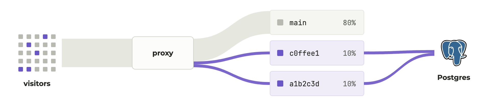

<br>

<div align="center">
  <a href="https://statespace.com">
    <picture>
      <source media="(prefers-color-scheme: dark)" srcset="https://raw.githubusercontent.com/statespace-tech/statespace/main/assets/header-dark.png">
      <source media="(prefers-color-scheme: light)" srcset="https://raw.githubusercontent.com/statespace-tech/statespace/main/assets/header-light.png">
      
    </picture>
  </a>
</div>

<div align="center">

<br>

[](https://github.com/statespace-tech/statespace/actions/workflows/ci.yml)
[](https://crates.io/crates/statespace)
[](https://github.com/statespace-tech/statespace/blob/main/LICENSE)
[](https://discord.gg/qKEFpqG9mr)

</div>

Statespace lets you A/B test code changes on your own infrastructure. A reverse proxy runs beside your app and routes a small share of your traffic to experimental versions of it. Their requests, logs, and events land in Postgres so your agents can query and act on them.

<picture>
  <source media="(prefers-color-scheme: dark)" srcset="https://raw.githubusercontent.com/statespace-tech/statespace/main/assets/how-it-works-dark.png">
  <source media="(prefers-color-scheme: light)" srcset="https://raw.githubusercontent.com/statespace-tech/statespace/main/assets/how-it-works-light.png">
  
</picture>

<p align="center">
  <a href="https://docs.statespace.com/guides/docker">Docker</a> ·
  <a href="https://docs.statespace.com/guides/kubernetes">Kubernetes</a> ·
  <a href="https://docs.statespace.com/guides/cloud-run">Cloud Run</a> ·
  <a href="https://docs.statespace.com/guides/fargate">ECS Fargate</a> ·
  <a href="https://docs.statespace.com/guides/fly">Fly.io</a> ·
  <a href="https://docs.statespace.com/guides/s3">S3</a> ·
  <a href="https://docs.statespace.com/guides/gcs">Cloud Storage</a>
</p>

## Quickstart

1. Install the CLI and sign in with GitHub:

   ```shell
   curl -fsSL https://statespace.com/install.sh | bash
   ssp login
   ```

2. Install the
   [GitHub App](https://github.com/apps/statespace-tech/installations/new)
   and add this step to your image build:

   ```yaml
   permissions:
     contents: read
     packages: write
     id-token: write

   steps:
     # ... your steps that build and push the image (id: build) ...
     - uses: statespace-tech/action@v1
       with:
         image: ghcr.io/acme/shop@${{ steps.build.outputs.digest }}
   ```

3. Add `statespace.toml` to your repo and define your experiment:

   ```toml
   [[event]]
   name  = "purchase"
   match = 'request.method == "POST" && request.path == "/checkout"'

   [[metric]]
   label = "conversion %"
   value = '100.0 * events["purchase"].subjects / subjects'

   [experiment.checkout]
   subject     = 'request.headers["x-user-id"]'
   eligibility = 'request.headers["cf-ipcountry"] == "US"'  # behind Cloudflare
   ```

4. Create your app and its proxy token:

   ```shell
   ssp app add shop-prod
   ssp token add --app shop-prod
   ```

5. Run the proxy next to your app and point your traffic at it:

   ```shell
   STATESPACE_TOKEN=<token> ssp proxy kubernetes --deployment shop
   ```

6. Give two commits a share of traffic and start:

   ```shell
   ssp experiment update checkout --arm c0ffee1=0.1 --arm a1b2c3d=0.1
   ssp experiment start checkout --note "one-page checkout"
   ```

7. Compare the versions in Postgres:

   ```text
   $ psql "$(ssp db url)"
   acme=> SELECT arm, count(*) AS purchases
   acme->   FROM events
   acme->   WHERE experiment = 'checkout' AND name = 'purchase'
   acme->   GROUP BY arm;

      arm   | purchases
   ---------+-----------
    c0ffee1 |        71
    a1b2c3d |        84
   (2 rows)
   ```

## Community

Ask questions on [Discord](https://discord.gg/qKEFpqG9mr), and report bugs
in [issues](https://github.com/statespace-tech/statespace/issues). See
[CONTRIBUTING.md](https://github.com/statespace-tech/statespace/blob/main/CONTRIBUTING.md) for more info.

## License

Apache-2.0
